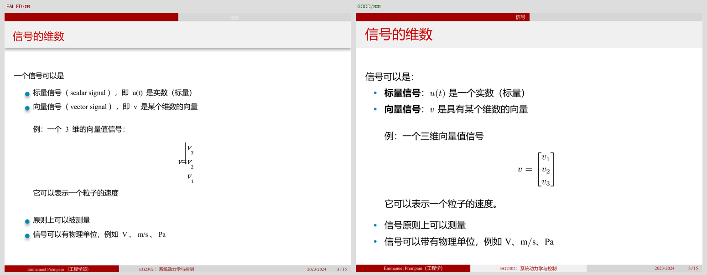

# DSH Native Textbook Pack

> Rebuild technical books, textbooks, scanned books and slide decks into **native Chinese LaTeX PDFs** — editable math and tables, vector or redrawn figures, rendered-page and visual review — and ship the PDF together with compilable TeX sources.

This is a skill pack + conversion engine (Native Forge) + field notes for **DeepSeek Harness (DSH)**. The full documentation is in Chinese: see **[README.md](README.md)**.



## What it does

- Read-only source preflight → evidence packet → semantic TeX → build → technical QA → typography checks → visual review → release.
- Math and tables must be native LaTeX (no screenshot fallbacks); figures keep source vectors or are redrawn natively.
- Every release is gated by source hashes, a build fingerprint, a completed review record and an independent reviewer.
- Ships 10 DSH skills, the Native Forge engine, an offline PyMuPDF wheel, 6 Chinese playbooks and 12 real session transcripts.

## Quick start (Windows)

Requirements: Windows 10/11 or macOS 13+ (Apple silicon), with a DSH desktop installation (official download: <https://www.deepseek.com/download/>; this repo does not ship it). TeX Live is required later to compile PDFs.

```powershell
git clone https://github.com/liudayewangzhe/dsh-native-textbook-pack.git
cd dsh-native-textbook-pack
.\install.cmd
```

Then **fully quit and restart DSH**, open a new session and say:

> Use the native-textbook skill to translate chapter 3 of `D:\books\source.pdf` into a native Chinese textbook. Math and tables must stay editable, figures should keep vectors or be redrawn, and deliver the PDF plus the TeX sources after checking the content and every output page.

If the skill is not picked up automatically, ask DSH to read:

```text
%USERPROFILE%\.dsh\skills\native-textbook\SKILL.md
```

Verify the install:

```powershell
$NF = "$env:USERPROFILE\.dsh\native-forge\nf.cmd"
& $NF doctor        # ok:true, pymupdf.available:true, templates.ok:true, xelatex.found:true
```

Linux/macOS: there is **no one-click installer**; follow the manual steps in [docs/INSTALL.md](docs/INSTALL.md) §7.

## Documentation

| Document | Content |
|---|---|
| [README.md](README.md) | Full Chinese guide: install, self-check, dependencies, workflow, commands, FAQ, limits |
| [docs/INSTALL.md](docs/INSTALL.md) | Installer parameters, manual/offline install, upgrade, uninstall, Linux/macOS steps |
| [docs/WORKFLOW.md](docs/WORKFLOW.md) | End-to-end stages, commands, artifacts, acceptance gates, failure reasons |
| [docs/DEPENDENCIES.md](docs/DEPENDENCIES.md) | Required/optional dependencies, verified download URLs and China mirrors, verification steps |
| [docs/FAQ.md](docs/FAQ.md) | Troubleshooting: execution policy, missing skills/PyMuPDF/xelatex, glyphs, RAM gate, sandbox ACL, encoding, encrypted PDFs, scanned sources |
| [playbook/](playbook/01-总览与取舍.md) | Chinese field notes (overview, environment, commands, pitfalls, session retrospectives, examples) |

## Verify integrity

```powershell
python verify_pack.py          # exit 0 = all files match MANIFEST.json
```

## Scope and limits

- Windows first; Linux/macOS are manual and untested in this repository.
- TeX Live (XeLaTeX, ctex, CJK fonts) must be installed separately; it is not bundled.
- Low-memory hosts are throttled by a 1 GiB free-RAM gate — by design.
- Scanned sources require per-object inventory and human visual review; no "care-free OCR" promise.
- You are responsible for the rights to translate and distribute the source material.
- PyMuPDF is AGPL-3.0; see [NOTICE.md](NOTICE.md) and [LICENSES/](LICENSES/).

## License

Original content is [MIT](LICENSE). Third-party components keep their own licenses; see [NOTICE.md](NOTICE.md).
