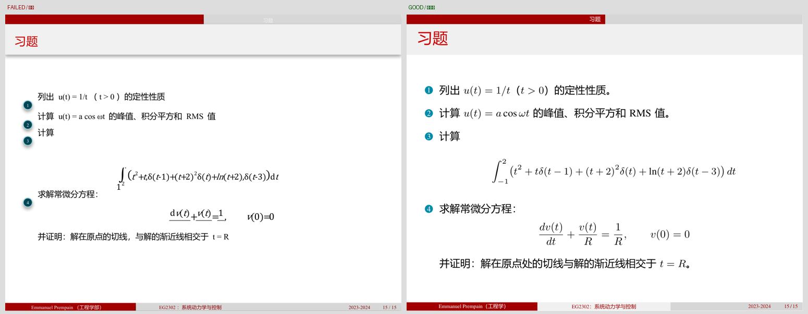

# 工作流：从原稿 PDF 到可复编的原生中文 PDF

本文给出**端到端、可照跑**的阶段顺序：每阶段有命令、产物、验收门和常见失败原因。所有命令以仓库内真实 CLI 为准（`nf.cmd` 的 `--help` 与 `engine/native-forge/scripts/*.py` 的 argparse 均已核对）。

> 术语约定：**证据包**是 `prepare` 产出的只读来源材料（`packet/`）；**门禁**是必须实际通过才能进入下一阶段的检查；**视觉复核**是看渲染图，不是跑脚本。

---

## 0. 先确定交付形态与范围

在动手之前锁定三件事，否则后面全部返工：

| 判断 | 选哪条路 |
|---|---|
| 教材式连续阅读、章节重组、需要目录/页码/跨页接排 | **book**：本文主线，走 `nf.cmd` 的 `prepare/build/qa/release` |
| 保留 PPT 风味、一源页 = 一输出页、横版课件 PDF | **slide**：独立 XeLaTeX 链，**不走 `nf.cmd release`**，见 `skills/native-textbook/references/slide-native-pdf.md` |
| 可编辑 `.pptx` | 走 DSH 的 `office-pptx` 分支，不是本引擎 |

同时写清楚：**原稿绝对路径、PDF 物理页码范围、交付物（PDF + TeX 源码）、哪些内容不做**。范围写进项目与任务单，后续所有检查都以它为准。

> 形态判断的实测教训见 [playbook/01-总览与取舍.md](../playbook/01-总览与取舍.md) §2。

---

## 1. 阶段总览

```text
原稿 PDF
  │
  ├─(1) preflight     只读前检：来源哈希、逐页观测、风险候选
  │        └─ 产物：preflight/book-a.json + corpus.json
  │
  ├─(2) plan          版式计划：几何、内容路线、风险样张、试点
  │        └─ 产物：planning/preflight.json + layout-plan.json（check 退出码 0）
  │
  ├─(3) prepare       证据包：按物理页码抽取只读 packet
  │        └─ 产物：project.json / content.json / assets.json / packet/
  │
  ├─(4) draft         分块起草：worker 只写自己的 chunk，产出语义 TeX
  │        └─ 产物：chunks/NNNN.json（+ figures/、可选 asset/redraw）
  │
  ├─(5) merge         按阅读顺序合并 + 覆盖校验
  │        └─ 产物：content.json + merge-ledger.json
  │
  ├─(6) build         XeLaTeX 编译
  │        └─ 产物：build/main.pdf / main.tex / main.log / fingerprint.json（compiled）
  │
  ├─(7) qa            技术检查 + 生成复核模板
  │        └─ 产物：qa/qa_report.json / qa/layout_report.json / review.json（technical_pass）
  │
  ├─(8) 排版与视觉材料  几何检查、字号回抽、接触表/高倍页
  │        └─ 产物：qa/typo.*、qa/size-compare.*、qa/review/（reviewed 的前置）
  │
  ├─(9) 视觉复核      看全部输出页 + 独立审查；填 review.json
  │        └─ 产物：绑定当前 build_fingerprint 的 review.json（reviewed）
  │
  └─(10) release      重跑 qa、校验 review、打包
           └─ 产物：deliverable/ + deliverable.zip（released）
```

四个状态必须区分，不能互相替代：

| 状态 | 含义 | 能交付吗 |
|---|---|---|
| `compiled` | XeLaTeX 退出码 0 | **不能**——未转义的 `%` 能让内容静默消失而编译成功 |
| `technical_pass` | `qa` 通过：页数/越界/原生对象/字体/栅格/指纹 | **不能**——不证明数学、语义、视觉正确 |
| `reviewed` | 全部源页与输出页实际对照 + 视觉复核，记录绑定当前指纹 | 接近，还要过发布打包 |
| `released` | `nf.cmd release` 通过 | 可以 |

---

## 1.1 路径与变量约定

```powershell
$NF   = "$env:USERPROFILE\.dsh\native-forge"          # 引擎安装目录
$SK   = "$env:USERPROFILE\.dsh\skills\native-textbook" # 技能目录
$PY   = '<带 PyMuPDF 的 python.exe>'                   # 见 docs/DEPENDENCIES.md §2/§3
$SRC  = 'D:\书\原稿.pdf'                                # 原稿（只读）
$PROJ = 'D:\work\mybook'                                # 项目目录（可写）
$WORK = 'D:\work\mybook-work'                           # 前检/计划等中间产物

# 直接调用技能里的 Python 脚本时，需要让解释器找到引擎的 pylibs：
$env:PYTHONPATH = "$NF\pylibs;$env:PYTHONPATH"
```

`nf.cmd` 自己会设置 `PYTHONPATH` 与 UTF-8，直接用 `& $NF\nf.cmd ...` 不需要额外处理。

---

## 2. preflight：只读前检

**目的**：搞清原稿里有什么（文字层/扫描、图、表、数学、多栏、边注、二维码候选、加密），据此决定制作路线。**不翻译、不 OCR、不产出"通过"结论。**

```powershell
# 2.1 写清单（用 Python 写，避免 Windows PowerShell 的 BOM 坑）
& $PY -c "from pathlib import Path; import json; Path(r'$WORK\inputs.json').write_text(json.dumps([{'id':'book-a','path':r'$SRC'}], ensure_ascii=False), encoding='utf-8')"

# 2.2 跑前检
& $PY "$NF\scripts\preflight_pdf.py" --manifest "$WORK\inputs.json" --out "$WORK\preflight"
```

**产物**

- `$WORK\preflight\book-a.json`：单书逐页观测（尺寸/旋转/文字量/图区/矢量计数/链接/候选）
- `$WORK\preflight\corpus.json`：多来源汇总

**验收门**

- 返回 0，`status: complete`，且 `source_unchanged_after_scan: true`（扫描前后原稿哈希一致）
- 对扫描页/公式页/宽页等**代表页看图确认**，把"机器观测 / 启发式候选 / 看图确认 / 未验证能力"分层记录

**常见失败**

| 现象 | 原因 | 处理 |
|---|---|---|
| `json.decoder.JSONDecodeError` | `inputs.json` 带 BOM 或不是数组 | 用 Python 写 JSON，格式必须是 `[{"id":...,"path":...}]` |
| `encrypted PDF needs an authorized password` | PDF 有密码 | 先解密再前检；本包不内置解密（见 [FAQ](FAQ.md#加密-pdf)） |
| 内存不足中止 | 空闲内存低于 1 GiB | 腾内存后重跑（见 [FAQ](FAQ.md#内存门禁)） |

> 前检证明"我观测了什么"，不证明"内容已识别正确"。字段含义见 `engine/native-forge/docs/preflight.md`。

---

## 3. plan：版式计划（先规划、试排，再扩量）

**目的**：把"证据 → 决定 → 样张试排 → 放行"落成可检查的文件，避免 worker 凭候选数量猜版式。

```powershell
# 3.1 建立计划（把前检复制进项目并绑定 SHA-256）
& $PY "$NF\scripts\plan_document.py" scaffold --preflight "$WORK\preflight\book-a.json" --project "$PROJ"

# 3.2 填写决定后校验（首次 check 会失败，这是设计）
& $PY "$NF\scripts\plan_document.py" check --project "$PROJ"
```

**产物**

- `$PROJ\planning\preflight.json`（前检快照 + 哈希）
- `$PROJ\layout-plan.json`：`geometry`、`content_routes`、`risk_cases`、`pilot`、`worker_contract`、`unresolved`

**验收门**

- `check` **退出码 0**（缺项/过期/不合法返回 2）
- `plan_ready:true` **不等于**内容或美观验收；风险样张必须真实编译、真实看图

**常见失败**

| 现象 | 原因 | 处理 |
|---|---|---|
| 首次 `check` 失败 | 新建计划所有决定为空、`pilot.status:pending` | 按 `engine/native-forge/docs/document-plan.md` 填真实决定与样张 |
| 指向 `corpus.json` 报错 | scaffold 只接受单书报告 | 传 `book-a.json` |
| 已有 `build/main.pdf` 却拒绝 scaffold | 需要回填身份 | 加 `--retrospective`（并在文档里如实注明） |

---

## 4. prepare：抽取证据包

**目的**：把用户授权的页码范围抽成只读证据包；`project.json` 里记录**来源哈希与页码**，这是本轮工作的**事实边界**。

```powershell
& $NF\nf.cmd prepare --source "$SRC" --pages 24-32 --project "$PROJ" --title '计算物理：从原理到实践'

# 多段范围写法（物理页码，从 1 开始）
& $NF\nf.cmd prepare --source "$SRC" --pages '1,13-65,69-89' --project "$PROJ" --title '书名'
```

**产物**

```text
$PROJ\
├── project.json              # 来源 path/sha256、pages、title、templates 哈希、status
├── content.json              # 空骨架（blocks/exclusions/unresolved/expectations）
├── assets.json               # 图资产登记表（初始 {}）
└── packet\
    ├── packet.json           # 每页 JSON/PNG 的 sha256 索引 + source_sha256
    └── pages\
        ├── p0024.json        # 文本块（id/page/bbox/text）、图与矢量统计
        └── p0024.png         # 页面渲染图：只供识别与核验，禁止嵌入成品
```

**验收门**

- 返回 JSON：`"command": "prepare"`、`"content": "created"`、`"pages": [...]`、`"source_sha256": "..."`（首次）
- 重跑同一范围返回 `"cached": true`；原稿变了会重新抽取
- 文件结构与 `examples/project-skeleton/` 一致（该目录是**合成样张**、模板路径为占位符，不能直接 build）

**常见失败**

| 现象 | 原因 | 处理 |
|---|---|---|
| `source PDF changed since prepare` | 原稿被修改/替换 | 重新 `prepare`，旧复核与旧构建全部作废 |
| 页码超范围 | `--pages` 是物理页码，不是印刷页码 | 用 PDF 阅读器的物理页序核对 |
| 扫描页 `packet` 里几乎没有文字块 | 没有文字层 | 走扫描件路线：`source_inventory.json` + worker 逐对象转写（见 §5.4） |

> **`prepare` 之后不能直接 build**：`content.json` 还是空骨架，`build` 会明确报 `blocks must contain native content`。这是设计，不是故障。

---

## 5. 分块起草（worker）

**目的**：把语义小节翻译并重建为**原生 TeX**。worker 的写入范围**只有一个 chunk 文件**；共享文件（`content.json`、`assets.json`、模板、`review.json`）由监工统一负责。

### 5.1 派单

- 模板：`examples/worker-brief-template.md`（book / 扫描件 / 独立审查 / 单人版四种）
- 合同：`skills/native-textbook/references/worker-contract.md`
- 一个 worker 只给一个可写窄范围；每批建议 **3 页**（5 页以上失败率明显上升）
- 任务书必须写真实路径、页码、术语表、版式规则，以及**踩过的坑**（如"不要把页首当上一页续文跳过"）

### 5.2 worker 输出

```json
{
  "title": "<章标题中文>",
  "blocks": [
    {"id": "p0024-p1", "kind": "paragraph", "source_ids": ["p0024-b0001"], "tex": "……"},
    {"id": "p0024-e1", "kind": "equation", "source_ids": ["p0024-b0002"],
     "numbered": true, "tex": "\\begin{equation}\n...\n\\tag{1.5}\n\\end{equation}"},
    {"id": "p0024-f1", "kind": "figure", "asset": "f0024-1.2", "caption": "", "width": 0.8,
     "source_ids": ["p0024-b0003"]}
  ],
  "exclusions": [{"source_id": "p0024-b0009", "category": "header_footer", "reason": "running head"}],
  "source_notes": [],
  "unresolved": [],
  "expectations": {"equation_tags": ["1.5"], "table_count": 0, "figure_count": 1, "required_strings": []}
}
```

**合法 block kind**：`chapter / section / subsection / paragraph / equation / table / figure / figure_native`；边注用 `note`。
**硬约束**：每个来源证据 ID 要么被某个 block 的 `source_ids` 引用，要么进入 `exclusions`（二选一）；公式、表格**必须原生 TeX**，不能截图回退；`figure` 块不写 `tex`、不写 `\includegraphics`。

### 5.3 图资产（可选，监工或 worker 按授权执行）

```powershell
# 从来源页登记矢量/位图资产；bbox 是完整来源页的 PDF 点坐标
& $NF\nf.cmd asset --project "$PROJ" --page 29 --bbox 316.69 207.98 548.84 355.26 `
  --name f0029-1.1.2 --kind source_raster

# 简单图重绘为原生 TikZ/PGFPlots/chemfig（规范 JSON 由 agent 写）
& $NF\nf.cmd redraw --project "$PROJ" --spec "$PROJ\figures\f12.json" --name f12-native
```

`--kind`：`vector_pdf` / `source_raster` / `source_pdf` / `page_raster`。
`--figure-kind`：`photograph` / `plot` / `schematic` / `mixed` / `qr_code`。
**先看图再登记**：bbox 只含图体，不含印刷图题；图例、刻度、反应条件、立体化学标记都算内容。

### 5.4 扫描件分支

无文字层的页面不能靠抽取文本，必须由监工按整页对象建清单：

```powershell
& $PY "$NF\scripts\scaffold_inventory.py" --project "$PROJ"
```

然后 worker 按 `source_inventory.json` 的逐对象结构（`id/page/bbox/kind/text`）转写；空扫描页只能用 `blank:true, checked:true, reason`，且必须真的看过图。完整流程见 `skills/native-textbook/references/scanned-source-repair.md`。

### 5.5 验收门（每个 chunk）

- JSON 合法，`kind` 与字段符合合同；`expectations` 来自阅读原稿，不是从生成结果反推
- 覆盖检查通过（见 §6）；无截图公式/表格；无未说明的省略
- 内容正确性仍要由监工对照原稿确认——**覆盖检查不证明译文正确**

---

## 6. merge：合并 chunk

**目的**：把独立 chunk 按阅读顺序合成一份 `content.json`，并做覆盖校验。**只有通过校验的合并才会替换当前稿。**

```powershell
& $PY "$NF\scripts\merge_chunks.py" --project "$PROJ" `
  --chunks "$PROJ\chunks\0000.json" "$PROJ\chunks\0001.json" "$PROJ\chunks\0002.json"
```

`--chunks` 的**文件顺序就是阅读顺序**（`nargs='+'`）；建议在项目里另存 `chunk_order.json` 记录顺序与页区间。

**产物**

- `$PROJ\content.json`（写入前先落 `content.merge.pending.json`，再原子替换）
- `$PROJ\merge-ledger.json`：每个 chunk 的路径与 SHA-256、被合并的重复页眉、边界排除项

**验收门**

- 命令退出 0；`validate_content` 通过（覆盖、资产引用、期望字段）
- 没有未解决的来源块、冲突排除项或重复 ID

**常见失败**

| 现象 | 原因 | 处理 |
|---|---|---|
| `invalid semantic chunk` | chunk 不是合法 JSON 或没有 `blocks` 数组 | 先修 JSON（扫描件有 `fix_bad_json.py`） |
| `chunk has no source-derived expectations` | 缺 `expectations` | 读原稿补真实值 |
| `included content conflicts with exclusion` | 同一 source_id 既引用又排除 | 按实际决定二选一；范围边界用 `out_of_scope` + `source_notes` 说明 |

---

## 7. build：编译

```powershell
& $NF\nf.cmd build --project "$PROJ"
```

**产物**

```text
$PROJ\build\
├── main.pdf               # 成品
├── main.tex               # 入口（含内容、资源引用）
├── main.log / main.aux
├── pass-1.stdout.txt ...  # 每遍 XeLaTeX 的 stdout/stderr
├── fingerprint.json       # 构建指纹（输入文件 + 模板 + 资产哈希）
├── elegantbook.cls
├── nativeforge.sty
└── assets\...
```

**验收门**

- 退出码 0，`build/main.pdf` 存在
- 返回 JSON 含 `build_fingerprint`
- 编译日志无 `Missing character`、无未定义引用、无 overfull 到溢出边界的严重项（这些 `qa` 还会再查）
- `project.json.status` 在 build 后为 `draft`

**常见失败**

| 现象 | 原因 | 处理 |
|---|---|---|
| `xelatex not found on PATH` | 没装 TeX Live 或没进 PATH | 见 [DEPENDENCIES](DEPENDENCIES.md) §4 |
| `blocks must contain native content` | `content.json` 还是空骨架 | 先完成 §5–§6 |
| `File 'xxx.sty' not found` | 宏包缺失 | `tlmgr install xxx` |
| `Missing character` | 字体缺字形 | 换 Fandol/Noto CJK，或按 `playbook/04` §F 处理罗马数字等特殊字符 |
| `engine source changed after import` | 构建期间改了引擎源码 | 重启命令后重跑 |

> **不要把"编译成功"当成"翻译正确"**。`%` 未转义、`nullfont`、公式分母被裁掉，都能在退出码 0 的情况下发生。

---

## 8. qa：技术检查

```powershell
& $NF\nf.cmd qa --project "$PROJ"
```

**产物**

- `$PROJ\qa\qa_report.json`：`status`、`build_fingerprint`、页数、越界/原生对象/栅格统计、`findings`
- `$PROJ\qa\layout_report.json`：版式几何实测
- `$PROJ\review.json`：首次 `qa` 自动生成的复核模板（所有页 `checked:false`）
- `$PROJ\review-template.json`：同一模板的副本

**验收门**

- `qa_report.status: "pass"`，`findings: []`
- `review.fingerprint_current: true`（若已有 `review.json` 与当前构建不符，项目会退回 `draft`）
- `qa` **通过也不会自动把项目变成 `reviewed`**

**常见失败**

| 现象 | 原因 | 处理 |
|---|---|---|
| `qa failed with N finding(s)` | 有越界/缺字/原生对象/期望不符 | 按 `qa/qa_report.json` 的 `findings` 逐条修，改完重 build 再 qa |
| `review is bound to a different build fingerprint` | 构建变了但 review 没更新 | 重新看图并更新 `review.json`（旧复核对新 PDF 无效） |

---

## 9. 排版几何、字号回抽与视觉材料

这三件事是 `qa` 之后、`release` 之前的**额外证据**，都读 `build\main.pdf`。

```powershell
# 9.1 排版几何：越纸、压字、行距节奏、版心留白、行末填充率
& $PY "$SK\scripts\check_typography.py" --pdf "$PROJ\build\main.pdf" --mode book `
  --out "$PROJ\qa\typo.json" --report "$PROJ\qa\typo.md" --fail-on error

# 9.2 字号/行距回抽：源 vs 交付（硬门禁）
& $PY "$SK\scripts\compare_typography.py" --source "$SRC" --target "$PROJ\build\main.pdf" `
  --mode book --out "$PROJ\qa\size-compare.json" --report "$PROJ\qa\size-compare.md"

# 9.3 看图材料：接触表（L1 全页） + 高风险页高倍（L2） + 可选 Poppler 第二渲染器
& $PY "$SK\scripts\render_review_sheets.py" --pdf "$PROJ\build\main.pdf" --out "$PROJ\qa\review" `
  --sheet-pages 6 --thumb-width 480 --hi-res-pages "1,3,5,6,8" --hi-res-zoom 3 --poppler-dpi 144
```

**产物**

- `qa\typo.json` / `qa\typo.md`
- `qa\size-compare.json` / `qa\size-compare.md`（关键指标 `body_scale_ratio`）
- `qa\review\contact-01.png` 等接触表、高倍 PNG，以及 `qa\review\manifest.json`（记录输入 PDF 的 SHA-256、每页 PNG 的 SHA-256、缩放倍数与工具）

**验收门**

- `check_typography.py --fail-on error` 退出 0（它只给**几何事实**，不证明好看）
- `compare_typography.py`：`body_scale_ratio` ≈ 1.0；`--mode book` 同语言重排容差 ±3%，外文源→中文 `cross-language` 容差 ±10%。**≈0.75 是典型的 72/96 整册误缩**
- 接触表覆盖**全部输出页**；高风险页有 3× 高倍图，且（可选）有 Poppler 交叉渲染

> 说明：`playbook/03`、`examples/commands.ps1` 等材料已按当前引擎统一为 `$PROJ\build\main.pdf`。若你在其他历史材料里仍看到 `out\main.pdf`，那是旧版本路径；以本文为准。

---

## 10. 视觉复核与独立审查

**视觉复核是独立步骤**，不能用"脚本通过"或"我整体看过了"替代。

### 10.1 两级分辨率

| 级别 | 看什么 | 材料 |
|---|---|---|
| **L1** | **全部**输出页的整体版式：空白、挤压、浮动体、页码、页眉、图表位置 | `contact-*.png` 接触表（每张 6 页） |
| **L2** | 高风险页：公式上下标/积分限、表格单元格、图内标签、接缝页 | `--hi-res-pages` 的 3× PNG；可选 Poppler 144 dpi 交叉核对 |

### 10.2 复核记录 `review.json`

```json
{
  "schema_version": 1,
  "build_fingerprint": "<build/fingerprint.json 里的 build_fingerprint>",
  "source_pages":  [{"page": 24, "checked": true}],
  "output_pages":  [{"page": 1, "checked": true}],
  "translation_checked": true,
  "formula_table_checked": true,
  "issues": [],
  "reviewer": "<实际做复核的人/角色>"
}
```

`release` 会重跑 `qa` 并逐项检查：指纹一致、源页/输出页清单完整且 `checked:true`、两项 `*_checked:true`、`issues` 为空、`reviewer` 非空。

### 10.3 独立视觉审查者

- 独立审查者**不参与制作**，只拿成品 PDF 与审核图出结论；
- 结论写 `$PROJ\qa\review-<标识>.json`，绑定当前 PDF 的 SHA-256；
- 与监工结论冲突时，以看图证据为准；
- 制作人不得替审查者签字，worker 不得预填"通过"。



> 示例对照来自本仓库的真实复核材料：左图的积分限、导数写法、公式字体已损坏；右图为可编辑的原生数学。书籍项目同样要求逐页对照，只是版式与检查项不同。更多证据边界见 `skills/native-textbook/references/visual-audit.md` 与 `workflow-gates.md`。

---

## 11. release：发布

```powershell
& $NF\nf.cmd release --project "$PROJ"
```

`release` 会**重新跑一遍 `qa`**，再校验 `review.json`，任一不满足即拒绝并把项目留在 `draft`：

- 有 `unresolved` / 未覆盖来源页
- 图形类型错误（该矢量却是位图、公式/表格截图）
- 编译或原生对象检查失败
- 源页/输出页未全部复核
- 审查指纹过期
- `content.json` 里还有 `pending_pages`

**产物**

```text
$PROJ\
├── deliverable\
│   ├── main.pdf              # 成品 PDF
│   ├── main.tex              # 可编译入口
│   ├── elegantbook.cls / nativeforge.sty
│   ├── assets\...            # 图资产
│   ├── packet\pages\...      # 来源证据（供追溯，不是正文）
│   ├── project.json / content.json / review.json
│   ├── build_fingerprint.json
│   ├── qa\qa_report.json、layout_report.json、main.log
│   └── manifest.json         # deliverable 内逐文件 SHA-256
├── deliverable.zip
└── deliverable.zip.sha256
```

**发布后的建议动作**：把 `deliverable.zip` 解压到空目录，独立跑一次 `xelatex main.tex`（两遍），确认"可独立复编"；同时把交付范围与**未验证项（limits）**写进交付说明。

---

## 12. 大书分块与 worker 协作

| 原则 | 做法 |
|---|---|
| 按语义切，不按字符切 | 以章/小节为 chunk，保持证明、公式、表格完整；不在公式中间切断 |
| 一个 chunk 一个写入者 | worker 只写 `chunks/NNNN.json`；共享 `content.json`/`assets.json`/模板由监工统一改 |
| 每批小 | 每批 **3 页**为宜；上下文与失败率都随页数上升 |
| 顺序可恢复 | `chunk_order.json` 记录阅读顺序与页区间；merge 时显式列出文件 |
| 图资产集中管理 | 资产命名与登记由监工分配唯一名称，避免多 worker 抢同一张图 |
| 术语统一 | 一份共享术语表 + 相同数学宏；worker 只收与当前块相关的部分 |
| 失败只重做失败对象 | 已通过的 chunk、packet、资产复用；不整书重译 |
| 先样张后扩量 | 先用含公式/表格/图形的真实小节校准版式，样张通过才批量 |

长书并行/合并/恢复的完整说明见 `engine/native-forge/docs/large-book.md`；派单模板见 `examples/worker-brief-template.md`。

---

## 13. 检查能证明什么、不能证明什么

| 检查 | 能证明 | **不能**证明 |
|---|---|---|
| `build` 退出 0 | 没有致命 LaTeX 错误 | 内容正确、公式无误 |
| `qa` 技术检查 | 页数/几何/原生对象/字体/指纹符合配置 | 数学与语义正确、版面好看 |
| 覆盖检查 / 墨迹审计 | 证据被分配、没有整行未覆盖 | 译文没有错译、漏句 |
| `check_typography` | 几何事实（越界、重叠、行距、留白） | "页面好不好看"、图内标注是否合理 |
| `compare_typography` | 字号/行距的整体比例与逐级偏差 | 字体选择、断行质量 |
| 视觉复核记录 | 有人实际看过并绑定当前 PDF | 看得够不够仔细（由审查纪律约束） |
| `release` | 上述门禁同时满足并打包 | 对任意新书、任意扫描稿的质量承诺 |

---

## 14. 延伸阅读

| 想了解 | 读 |
|---|---|
| 整体取舍、角色、放行五阶段 | [playbook/01-总览与取舍.md](../playbook/01-总览与取舍.md) |
| 环境与依赖、技能发现顺序、内存门槛 | [playbook/02-环境与依赖.md](../playbook/02-环境与依赖.md) |
| 全部命令与参数 | [playbook/03-命令速查.md](../playbook/03-命令速查.md) |
| 历史缺陷与判据 | [playbook/04-踩坑与注意点.md](../playbook/04-踩坑与注意点.md) |
| 真实会话怎么跑的 | [playbook/05-会话复盘.md](../playbook/05-会话复盘.md)、`sessions/` |
| 可直接复制的命令与任务书 | [playbook/06-示例用法.md](../playbook/06-示例用法.md)、`examples/` |
| 技能内部合同 | `skills/native-textbook/SKILL.md` 与 `references/` |
| 引擎设计、前检、长书、worker 合同 | `engine/native-forge/docs/` |
